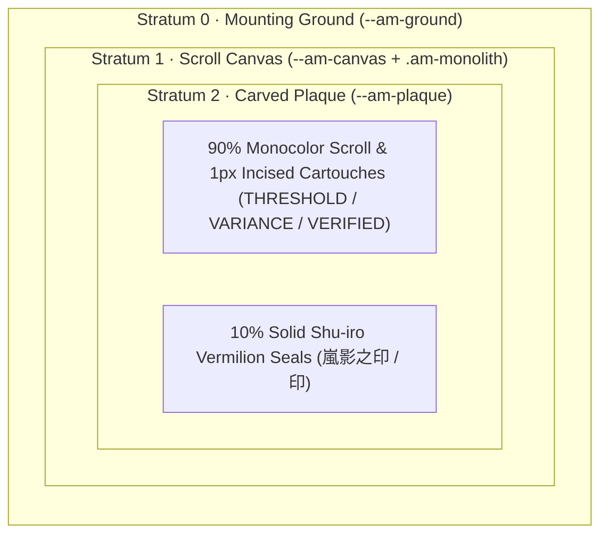

# ARASHIKAGE MONOLITH (`嵐影 · 銀座碑文`)
## The Definitive Design Language, Material Physics, Motion Choreography & Token Specification

> [!IMPORTANT]
> **System Identity**: `Arashikage Monolith` (`嵐影 · 銀座碑文`)  
> **Aesthetic Lineage**: Edo/Meiji *Mokuhanga* Woodblock Relief (`木版画`) × Documentary *Hanko* Scroll Authority (`判子 · 巻物`) × 1920s Tokyo *Ginza* Geometric Art Deco (`銀座アール・デコ`)  
> **Canonical Material Expressions**: `版画 · Hanga` (*Sumi Woodblock* — Default Dark) · `漆 · Urushi` (*Roiro Lacquer & Kintsugi Brass* — Gilded Dark) · `硯 · Suzuri` (*Carved Inkstone* — Low-Glare Dark) · `和紙 · Washi` (*Mulberry Parchment & Sumi Ink* — Light)  
> **Heraldic Emblem**: Hexagram 64 (`䷿ 未濟` *Wei Ji*) & Carved Maker Seal `嵐影之印` (*Seal of Storm & Shadow*)

---

## 1. Philosophy, Heritage & The Four Foundational Tenets (`思想と起源`)

**Arashikage Monolith (`嵐影 · 銀座碑文`)** is a comprehensive design language founded on **carved permanence, orthographic clarity, ceremonial restraint, and mechanical consequence**.

Born from the synthesis of **traditional Japanese woodblock printmaking (`木版画`)**, **the documentary authority of carved *Hanko* vermilion seals (`判子`) impressed upon hand-laid *Washi* scrolls (`巻物`)**, and **1920s Tokyo *Ginza* Geometric Art Deco architecture (`銀座アール・デコ`)**, the system treats the digital viewport not as an ephemeral projection of light, but as an **engraved architectural monolith**.

### Etymology & Heraldic Architecture (`嵐影 · ䷿ 未濟`)
- **`嵐影` (*Arashikage* — Storm & Shadow)**:
  - **Storm (`嵐` *Arashi*)**: Kinetic clarity, high-contrast typographic authority, and instantaneous legibility under cognitive load.
  - **Shadow (`影` *Kage*)**: Intentional negative space (*Ma* `間`), disciplined monochrome surfaces, and quiet structural composure.
- **Hexagram 64 (`䷿ 未濟` *Wei Ji* — Fire `☲` over Water `☵`)**:
  - Composed of six horizontal bars alternating unbroken (*Yang*) and broken (*Yin*) from top to bottom (`1-0-1-0-1-0`), Hexagram 64 represents the threshold where opposing forces lock into dynamic equilibrium. This alternating rhythm of solid structural rules and open intervals governs the spatial cadence, stepped borders, and ledger strata of the entire design language.

### The Four Foundational Tenets

| Tenet | Japanese Principle | Architectural Mandate |
| :--- | :--- | :--- |
| **I. Material Honesty** | `物質の誠実` (*Busshitsu no Seijitsu*) | Every surface is opaque, mineral, and structural. Hierarchy and depth are achieved through three-tier surface luminance and stepped architectural framing—never through optical blur, translucent frosting, or diffused drop shadows. |
| **II. Ceremonial Restraint (The 90/10 Law)** | `九分墨・一分朱` (*Kubu Sumi, Ichibu Shu*) | On an authentic scroll, the authority of the vermilion seal comes from the silence of the monochrome ink surrounding it. Ninety percent of every interface is composed of Sumi charcoal, Washi ivory, and incised mineral hairlines; solid *Shu-iro* vermilion is reserved exclusively for the ten percent that demands immediate human decision or verification. |
| **III. Orthographic Precision** | `幾何学的規律` (*Kikagakuteki Kiritsu*) | Containers meet at razor-sharp `0px` right angles framed by stepped ziggurat rules. Display typography stands upright with generous architectural tracking; all quantitative figures align in strict tabular columns (`tabular-nums`). |
| **IV. Mechanical Consequence** | `機構的応答` (*Kikōteki Ōtō*) | Interactive elements move with the physical certainty of a carved wooden seal striking paper, a cedar *Shōji* screen sliding in its groove, or a precision mechanical detent locking into place—free of elastic bounce, rubbery overshoot, or sluggish fade. |

---

## 2. Architectural Surface Physics & The Four Material Expressions (`構造と素材`)



### Three-Stratum Mineral Depth
Every viewport is constructed from **three opaque mineral strata** separated by crisp `1px` and `1.5px` structural rules:
1. **Stratum 0 — Mounting Ground (`--am-ground`)**: The outer architectural surround, analogous to the mounting silk and mineral backing of a hanging *Kakemono* scroll.
2. **Stratum 1 — Scroll Canvas (`--am-canvas`)**: The primary monumental work surface, bounded by the **Stepped Art Deco Ziggurat Frame** (`.am-monolith`: `border: 1.5px solid var(--am-outline); box-shadow: 0 0 0 4px var(--am-ground), 0 0 0 5.5px var(--am-rule);`).
3. **Stratum 2 — Carved Plaque (`--am-plaque`)**: Inside the Scroll Canvas, functional modules, comparative diptychs, and analytical ledgers occupy a distinct third luminance tier (`--am-plaque`—recessed *Kokutan* ebony in `Hanga`, elevated smoked umber lacquer in `Urushi`, carved slate in `Suzuri`, or luminous ivory silk in `Washi`).

> [!WARNING]
> **The Anti-Claustrophobia Law (Non-Nested Ziggurat Framing)**: The stepped double-rule frame (`.am-monolith`) is reserved **strictly** for top-level architectural containers. Child modules and ledger rows inside a monolith must **never** be wrapped in nested double-bordered boxes; they rest on open plaque strata divided by single `1px` hairlines (`--am-rule`).

### Cross-Section of the Stepped Ziggurat Frame & *Ma* (`間`) Spatial Scale
The signature `.am-monolith` perimeter is engineered as a **three-part architectural cross-section** (`5.5px` total stepped relief):
1. **Inner Structural Rule (`1.5px solid var(--am-outline)`)**: The high-contrast primary boundary (Washi Bone in `Hanga`, Kintsugi Brass in `Urushi`, Mineral Slate in `Suzuri`, Sumi Charcoal in `Washi`).
2. **Recessed Mounting Moat (`0 0 0 4px var(--am-ground)` — *Ma* `間`)**: A `4px` channel cut down to Stratum 0 (`--am-ground`) that isolates the monolith from surrounding elements without drop-shadows.
3. **Outer Registration Hairline (`0 0 0 5.5px var(--am-rule)` — *Kentō* `見当`)**: A `1.5px` outer registration hairline mirroring woodblock alignment marks.

| Spatial Token | Dimension | Architectural Application |
| :--- | :--- | :--- |
| `--am-space-rim` | `2px` (`0.125rem`) | Carved inner seal rim offset (`outline-offset: -2px` / `-3px`) |
| `--am-space-moat` | `4px` (`0.25rem`) | Ziggurat recessed moat & micro-gap between segmented controls |
| `--am-space-cartouche` | `8px` (`0.5rem`) | Horizontal rhythm between incised mineral cartouches |
| `--am-space-plaque` | `16px–20px` (`1.0rem–1.25rem`) | Internal padding of Stratum 2 Carved Plaques |
| `--am-space-gutter` | `20px–24px` (`1.25rem–1.5rem`) | Center structural gutter between Bilateral Comparative Diptychs |
| `--am-space-monolith` | `28px` (`1.75rem`) | Outer Scroll Canvas padding and vertical cadence between Monoliths |

### Two-Sided Woodblock Polarity (`陰陽`) & The Four Material Expressions
Rather than treating dark and light modes as mathematical inversions, **Arashikage Monolith** defines four physical material expressions that share identical geometry and spatial rhythm:

1. **`版画 · HANGA` (*Sumi Woodblock* — Default Dark Polarity)**:
   - *Physical Medium*: Carved cherrywood block inked with warm carbon *Sumi* (`#171412`), recessed *Kokutan* ebony plaques (`#0d0b0a`), and high-contrast *Washi* bone registration rules (`#d8d0c5`).
   - *Character*: Pure printmaking authority—stark, Graphic, and completely free of metallic ornament in its structural chrome.
2. **`漆 · URUSHI` (*Roiro Lacquer & Kintsugi Brass* — Gilded Dark Polarity)**:
   - *Physical Medium*: Mirror-black *Roiro-urushi* lacquer canvas (`#080705`), elevated smoked umber plaques (`#14110c`), inlaid burnished *Kintsugi* brass rules (`#c89d54`), and gilded champagne *Washi* slabs (`#ebe0cc`).
   - *Character*: Ceremonial luxury inspired by 1920s Tokyo Ginza architectural metalwork and Japanese lacquerware.
3. **`硯 · SUZURI` (*Carved Inkstone* — Low-Glare Dark Polarity)**:
   - *Physical Medium*: Weathered mineral *Suzuri* inkstone slate (`#14110e`) paired with warm stone-bone rules (`#a89a86`).
   - *Character*: Calibrated for extended low-ambient operation where softened rule contrast reduces ocular fatigue while preserving razor-sharp hierarchy.
4. **`和紙 · WASHI` (*Mulberry Parchment & Sumi Ink* — Light Polarity)**:
   - *Physical Medium*: Unbleached hand-laid *Kōzo* mulberry parchment (`#f4efe6`), luminous ivory silk plaques (`#fcfaf6`), dense carbon *Sumi* framing (`#1c1917`), and pressed *Shu-iro* cinnabar paste (`#b81d13`).
   - *Character*: Tactile editorial warmth—never sterile `#ffffff` hospital white or cold blue-gray.

---

## 3. Pigment Hierarchy, Semantic Seals & Functional Kanji Restraint (`色彩と印章`)

To prevent chromatic fatigue ("status-pill soup") and decorative Kanji clutter, every interface adheres to a **Three-Tier Pigment Hierarchy** and **Functional Kanji Restraint** (Kanji are used strictly where they serve a genuine functional purpose—such as the carved *Hanko* maker's seal, the subtle background maker's watermark, the four material expression names, or in place of a standalone icon—never as decorative prefixes prepended to English headings or secondary status tags):

### Tier 1: Solid *Shu-iro* Vermilion Seals (`≤ 10%` Canvas Area)
- **Tokens**: `--am-slab-counter` (`#b81d13` / `#a8180e`), `--am-slab-counter-ink` (`#fbf9f5`), `--am-vermilion` (`#d4261d` dark / `#b81d13` light).
- **Permitted Uses**:
  1. Square or vertical carved *Hanko* maker/section seals (`.am-hanko-stamp`: `[嵐影之印]`) with an inset `-3px` carved rim.
  2. Primary action or anomaly seals (`.am-seal-vermilion`: `[印 · CRITICAL ANOMALY]`, `[印 · GUIDE]`) where `印` serves directly in place of an action/alert icon with an inset `-2px` carved rim.
  3. The counterparty header slab in a bilateral comparative diptych (`.am-slab-counter`).
- **Prohibition**: No secondary classification tag (`THRESHOLD`, `VARIANCE`, `VERIFIED`, `ARCHIVE`) may ever use a solid colored fill.

### Tier 2: Inverted Monolith Slabs (Structural Counterweight)
- **Tokens**: `--am-slab-primary` (`#f4efe6` Washi Ivory in Dark Polarity; `#1c1917` Sumi Ink in Light Polarity) and `--am-slab-primary-ink` (`#12100e` in Dark Polarity; `#fbf9f5` in Light Polarity).
- **Permitted Uses**:
  1. Primary entity header slabs in bilateral comparative diptychs (`.am-slab-primary`).
  2. Active state locks in sequence timelines and primary command triggers (`.am-btn-primary`).

### Tier 3: `1px` Incised Mineral Cartouches (`90%` Monocolor Foundation)
All secondary classifications are incised directly into `--am-ground` or `--am-plaque` with a `1px solid` hairline border, clean tracked English typography (or geometric symbols `●`, `◆`, `⊘`), and restrained mineral ink:

| Semantic Role | Geometric Signifier | Class | Ink Token | Border Token | Universal Application |
| :--- | :---: | :--- | :--- | :--- | :--- |
| **Caution / Threshold** | `◆` / `⊘` | `.am-cartouche-gold` | `--am-gold` | `--am-gold-rule` | SLA thresholds, elevated load, cautionary variance |
| **Analytical / Relational** | `◆` | `.am-cartouche-steel` | `--am-steel` | `--am-steel-rule` | Secondary data series, correlation links, asymmetric load |
| **Equilibrium / Verified** | `●` | `.am-cartouche-celadon` | `--am-celadon` | `--am-celadon-rule` | Verified integrity, nominal equilibrium, positive delta |
| **Archival / Metadata** | `—` | `.am-cartouche-mono` | `--am-ink-secondary` | `--am-rule` | Timestamps, revision tags, neutral classifications |
| **Sovereign / Active** | `●` | `.am-cartouche-monolith` | `--am-ink-strong` | `--am-outline` | Active focal entity, primary node, locked selection |

---

## 4. Typographic Architecture & Orthographic Discipline (`文字組版`)

### The Four-Voice Typographic System

| Voice | Token | Typeface Stack | Structural Discipline |
| :--- | :--- | :--- | :--- |
| **1. Display Monument** | `--am-font-display` | `'Josefin Sans'`, `'Space Grotesk'`, `'Syne'`, sans-serif | Always `uppercase`, upright (`font-style: normal`—never faux-slanted italics), tight leading (`0.95` Hero, `1.08` Section), and architectural tracking (`0.06em` headlines; `0.12em–0.22em` kickers & friezes). |
| **2. Carved Seal Serif** | `--am-font-serif` | `'Noto Serif JP'`, serif (`700` / `900`) | Reserved strictly for functional kanji roles: square *Hanko* maker seals (`嵐影之印`), genuine icon-replacement glyphs (`印`, `陽`, `陰`), canonical material names (`版画`, `漆`, `硯`, `和紙`), and low-opacity (`2.5%–4%`) structural watermarks. |
| **3. Editorial Sans** | `--am-font-sans` | `'IBM Plex Sans'`, `'Inter'`, system-ui | Used for long-form documentation, analytical commentary, and body copy. Constrained to `58ch–68ch` measure with `1.6` line-height in `--am-ink-secondary`. |
| **4. Instrument Mono** | `--am-font-mono` | `'JetBrains Mono'`, monospace | Mandatory `font-variant-numeric: tabular-nums; font-feature-settings: "tnum" 1, "zero" 1;` across all metrics, deltas, timestamps, and ledger columns. |

### Typographic Scale & Spatial Grid (`4px` / `8px` Module)

| Level | Role | Size (`rem` / `px`) | Weight | Line Height | Tracking |
| :--- | :--- | :--- | :--- | :--- | :--- |
| `Display Hero` | Primary Monolith Masthead | `3.0rem` (`48px`) | `700` | `0.95` | `+0.06em` |
| `Section Monument` | Pillar / Module Heading (`H2`) | `1.875rem` (`30px`) | `700` | `1.05` | `+0.08em` |
| `Plaque Header` | Card / Diptych Entity Title (`H3`) | `1.375rem` (`22px`) | `700` | `1.10` | `+0.09em` |
| `Metric Monument` | Primary Quantitative Readout | `1.75rem–2.5rem` (`28px–40px`) | `800` | `1.00` | `-0.01em` (`tabular-nums`) |
| `Editorial Body` | Documentation & Prose | `0.9375rem–1.0rem` (`15px–16px`) | `400` / `500` | `1.60` | `0.00em` |
| `Ledger Cell` | Tabular Data Row | `0.8125rem` (`13px`) | `600` / `700` | `1.35` | `+0.02em` (`tabular-nums`) |
| `Frieze / Kicker` | Architectural Rule & Cartouche | `0.6875rem` (`11px`) | `700` | `1.15` | `+0.14em–0.22em` |

### Three Unbreakable Typographic Laws
1. **The Unified Monolith Headline Law**: Display headlines must **never** split into two colors mid-phrase or across line breaks. Headlines render in **100% unified `--am-ink-strong`** so the adjacent square vermilion *Hanko* seal (`[嵐影之印]`) commands the focal point without competition.
2. **Authentic Square *Hanko* Proportions**: A `.am-hanko-stamp` is a compact geometric square (`2.25rem × 2.25rem`) housing a 2×2 Kanji seal (`嵐影 / 之印`) with an inset carved rim (`outline-offset: -3px`). Never stretch a vermilion seal into a full-width horizontal sentence ribbon.
3. **The Primary Metric Monument Law**: In any analytical header or ledger card, the raw quantitative figure (`99.98%`, `1,480 MS`, `+42.8 Δ`) is the primary typographic monument (`1.35rem–2.25rem`, `font-weight: 800`), while classification metadata sits quietly beneath it (`0.6875rem`, `--am-ink-muted`).

### Heraldic Signifiers, Functional Kanji Restraint & Geometric Iconography (`紋章 · 記号`)
To preserve orthographic purity and prevent decorative Kanji noise, **Arashikage Monolith** enforces **Functional Kanji Restraint**: Kanji characters are never scattered as ornamental prefixes on English section headings, tabs, or status pills. Instead, visual signifiers are restricted to three purposeful classes:
1. **Carved *Rakkan* Maker Seals (`落款印`)**: `1:1` square vermilion blocks with `-3px` inset carved rims (`[嵐影之印]`) used to anchor mastheads, active focal nodes, and primary document strata.
2. **Functional Icon-Replacement Glyphs (`機能漢字`)**: Single Kanji characters used *strictly in place of a standalone icon* (`印` on Guide/Seal action triggers, `陽` / `陰` on Light/Dark polarity switches, and the 4 physical material expression badges `版画`, `漆`, `硯`, `和紙`).
3. **Orthographic Vector Glyphs (`幾何学記号`)**: Sharp miter-joined geometric glyphs restricted to `90°` and `45°` axes (`◆` Frieze Diamond, `●` Active Node, `⊘` Bypassed State, `↗` Dossier Vector, `✕` Dismiss Lock, `⇅` Stratum Unfurl, `⟳` Sequence Trigger, `Δ` Quantitative Variance, `䷿` Hexagram 64).

---

## 5. Spatial Architecture, Controls & Component Archetypes (`構成要素`)

### 1. Action Triggers & Segmented Controls
- **`.am-btn-primary` (Inverted Monolith Action)**: Solid `--am-slab-primary` background with `--am-slab-primary-ink` uppercase display text. Used for primary affirmative actions and active state locks.
- **`.am-btn-vermilion` (Sovereign Seal Action)**: Solid `--am-slab-counter` vermilion fill with `--am-slab-counter-ink` text and `-2px` inset outline. Reserved for high-consequence commits, overrides, or seal verification.
- **`.am-btn-incised` (Architectural Ghost Trigger)**: `--am-ground` background with `1px solid var(--am-outline)` border, snapping to `--am-canvas-subtle` on hover with a `1px` active press detent.
- **`.am-segmented` (Zero-Gap Polarity Switch)**: Contiguous horizontal control group bounded by `1px solid var(--am-outline)`, where the active segment locks into `.am-slab-primary`.

### 2. Form Instrumentation (`.am-input`, `.am-select`, `.am-toggle`)
- **Incised Inputs (`.am-input`)**: Recessed `--am-ground` field with `0px` corner radius and `1px solid var(--am-rule)`. On `:focus-visible`, the border snaps to `--am-outline` (`100ms`) and a `3px` vertical vermilion/brass chisel spine locks along the left edge.
- **Mechanical Detent Toggles (`.am-toggle`)**: Rectangular sliding block inside a `1px solid var(--am-outline)` track—never a rounded pill switch. Snaps between `STANDBY` (`--am-ground`) and `ARMED` (`--am-slab-primary`) along `--ease-chisel-snap`.

### 3. Bilateral Comparative Diptychs (`.am-diptych`)
When comparing two entities, clusters, or states side-by-side (`陽 PRIMARY ENTITY` vs. `陰 COUNTERPARTY`):
- **Opposing Full-Bleed Header Slabs**: The left monolith header uses `.am-slab-primary` (Washi Ivory in Dark Polarity; Sumi Ink in Light Polarity); the right monolith header uses `.am-slab-counter` (Carved Cinnabar `#b81d13`).
- **Single-Line Cartouche & Ledger Lock**: Cartouche strips and column headers never wrap onto a second line, ensuring every horizontal `1px` ledger rule aligns row-for-row across the center gutter.

---

## 6. Motion Physics & Choreography (`動態と所作`)

### Core Philosophy: Solid Mechanics, Zero Bounce, Zero Blur
In **Arashikage Monolith**, nothing is made of rubber and nothing is made of smoke.
- **Prohibited**: Spring physics with overshoot (`cubic-bezier(0.34, 1.56, 0.64, 1)`), elastic scaling, Gaussian blur transitions (`filter: blur()`), or slow ambient fades.
- **Mandated**: Motion behaves like **a carved wooden *Hanko* seal striking paper**, **a cedar *Shōji* screen gliding in a track**, or **a mechanical chronograph locking into a detent**.

### Canonical Motion Tokens

```css
:root {
  /* 1. The Hanko Strike (判子押し): High-velocity vertical descent, instant dead-stop on contact */
  --ease-hanko-strike: cubic-bezier(0.12, 0.98, 0.24, 1);
  --dur-hanko-strike: 160ms;

  /* 2. The Shoji Unfurl (巻物展開): Architectural sliding panel / scroll expansion */
  --ease-shoji-enter: cubic-bezier(0.22, 1, 0.36, 1);
  --ease-shoji-exit: cubic-bezier(0.4, 0, 0.85, 0.15);
  --dur-shoji-enter: 220ms;
  --dur-shoji-exit: 160ms;

  /* 3. The Chisel Snap (彫り込み): Instant mechanical detent for hover, focus, and active press */
  --ease-chisel-snap: cubic-bezier(0.05, 0.9, 0.1, 1);
  --dur-chisel-snap: 100ms;

  /* 4. The Chronograph Step (定刻刻み): Discrete mechanical step for state sequencers */
  --ease-chrono-step: steps(5, end);
  --dur-chrono-step: 550ms;
}
```

### The Five Signature Choreographies

#### 1. `判子押し` (*Hanko Strike* — Decisive Seal Impact)
When a primary vermilion seal arms or enters the viewport, it descends from `scale(1.22)` to `scale(1.0)` over `160ms` with `0.0%` overshoot while its carved inner rim (`outline-offset`) snaps from `+5px` to `-3px`, simulating physical ink compression on Washi fiber.

```css
@keyframes am-hanko-strike {
  0% {
    opacity: 0;
    transform: scale(1.22) translateY(-4px);
    outline-color: transparent;
    outline-offset: 5px;
  }
  45% {
    opacity: 1;
    transform: scale(0.985) translateY(0);
  }
  100% {
    opacity: 1;
    transform: scale(1) translateY(0);
    outline-color: color-mix(in oklab, currentColor 42%, transparent);
    outline-offset: -3px;
  }
}
```

#### 2. `定刻刻み` (*Chronograph Detent* — Discrete Sequence Lock)
Multi-stage verification timelines and asynchronous state sequencers use discrete `steps(5, end)` shutter ticks along a `2.5px` top Kintsugi bar during active interrogation. The instant a state commits, the cell snaps in `100ms` (`--ease-chisel-snap`) into **Inverted Monolith Polarity** (`--am-slab-primary`), while downstream cells dim to `STANDBY` (`opacity: 0.55`).

#### 3. `巻物展開` (*Shōji Unfurl* — Discrete Top-Layer `<dialog>` & Drawer Transitions)
Modal dossiers (`<dialog>`) and expandable drawers unfurl along a strict orthographic axis using `@starting-style`, `transition-behavior: allow-discrete`, and `overlay`—paired with a feature-detected `canTransitionDisplay()` exit helper.

#### 4. `同体転移` & `陰陽転移` (*Shared-Monolith & Cross-Polarity View Transitions*)
State transitions and material expression switches invoke `document.startViewTransition()` with feature detection, keeping shared seals and headers anchored along `--ease-shoji-enter` (`220ms`).

#### 5. `彫り込み` (*Incised Chisel Micro-Interactions*)
Interactive rows and controls snap their border from `--am-rule` to `--am-outline` (`100ms`), lock a `3px` vertical chisel spine along the left edge (`::before`), nudge directional glyphs `translate(2px, -2px)`, and step `translate(1px, 1px)` on `:active`.

---

## 7. Sumi-Line Data Visualization (`墨線図`)

All analytical charts and comparative meters follow **`墨線図` (*Sumi-sen-zu* — Sumi-Line Architectural Instrumentation)**:
1. **Miter Polyline Geometry**: Data trajectories use crisp `2px–2.5px` geometric polylines (`stroke-linejoin: miter; stroke-linecap: square;`) with square *Kentō* registration nodes (`8×8px` `<rect>`)—never smoothed cubic splines that obscure instantaneous inflection points.
2. **45° Architectural Woodblock Hatching**: Area fills and comparative allocation bars use `repeating-linear-gradient(±45deg, ...)` woodblock hatching instead of soft alpha gradients.
3. **Bilateral Polarity Encoding**: Primary series render in `--am-slab-primary` / `--am-outline`; counterparty or anomaly series render in `--am-slab-counter` (`#b81d13`); threshold ceilings render as dashed Kintsugi Gold (`--am-gold`) rules with a diamond (`◆`) callout.

---

## 8. Canonical Token Matrix (`--am-*` Specification)

| Canonical Token | `版画 · Hanga` (Sumi Woodblock — Default Dark) | `漆 · Urushi` (Roiro Lacquer & Brass — Gilded Dark) | `硯 · Suzuri` (Carved Inkstone — Low-Glare Dark) | `和紙 · Washi` (Mulberry Parchment — Light) | Architectural Role |
| :--- | :--- | :--- | :--- | :--- | :--- |
| `--am-ground` | `#0a0908` | `#050403` | `#0b0908` | `#ebe5d9` | Stratum 0 Mounting Ground |
| `--am-canvas` | `#171412` | `#080705` | `#14110e` | `#f4efe6` | Stratum 1 Scroll Canvas |
| `--am-plaque` | `#0d0b0a` | `#14110c` | `#1c1814` | `#fcfaf6` | Stratum 2 Carved Monolith Plaque |
| `--am-canvas-subtle` | `#211d1a` | `#1c1710` | `#241f1a` | `#e6dfd3` | Interactive Hover / Secondary Stratum |
| `--am-rule` | `#36302a` | `#3b2e1d` | `#362e26` | `#cfc7b8` | `1px` Internal Ledger Hairline |
| `--am-outline` | `#d8d0c5` | `#c89d54` | `#a89a86` | `#1c1917` | `1.5px` Monolith & Ziggurat Frame |
| `--am-frieze` | `#cfc6b8` | `#d4a853` | `#bfb29e` | `#4a3f33` | Frieze & Section Kicker Ink |
| `--am-ink` | `#f4efe6` | `#f4ede1` | `#ede6d8` | `#171412` | Primary Body Ink |
| `--am-ink-secondary` | `#c9c0b1` | `#cbbda6` | `#bfb5a2` | `#362f28` | Editorial Prose & Secondary Ink |
| `--am-ink-muted` | `#8f8476` | `#968367` | `#8f8270` | `#615548` | Captions & Sub-labels (`≥ 4.6:1` WCAG AA) |
| `--am-ink-strong` | `#fbf9f5` | `#fffdf9` | `#fbf8f3` | `#090807` | Monumental Headlines & Primary Figures |
| `--am-slab-primary` | `#f4efe6` | `#ebe0cc` | `#e6dfd3` | `#1c1917` | Primary Entity (`陽`) Monolith Slab Fill |
| `--am-slab-primary-ink` | `#12100e` | `#120f0c` | `#12100e` | `#fbf9f5` | Ink on Primary Entity (`陽`) Slab |
| `--am-slab-counter` | `#b81d13` | `#a8180e` | `#b81d13` | `#b81d13` | Counterparty (`陰`) Slab & Hanko Seal Fill |
| `--am-slab-counter-ink` | `#fbf9f5` | `#fffdf9` | `#fbf8f3` | `#fbf9f5` | Ink on Counterparty (`陰`) Slab & Seal |
| `--am-vermilion` | `#d4261d` | `#d4261d` | `#d4261d` | `#b81d13` | Inline Vermilion Accent Ink |
| `--am-gold` | `#deb052` | `#e5b85c` | `#deb052` | `#8c5604` | `THRESHOLD` Kintsugi Gold Ink |
| `--am-gold-rule` | `#7a5c22` | `#856428` | `#7a5c22` | `#b48a3e` | `THRESHOLD` Cartouche Hairline |
| `--am-steel` | `#7da8c4` | `#7da8c4` | `#7da8c4` | `#1b4965` | `VARIANCE` Aizome Steel Ink |
| `--am-steel-rule` | `#2d556e` | `#2d556e` | `#2d556e` | `#6b9ab8` | `VARIANCE` Cartouche Hairline |
| `--am-celadon` | `#82a890` | `#82a890` | `#82a890` | `#1e523b` | `VERIFIED` Seiji Celadon Ink |
| `--am-celadon-rule` | `#2d523d` | `#2d523d` | `#2d523d` | `#63a38a` | `VERIFIED` Cartouche Hairline |

---

## 9. The 10 Principles of Arashikage Craft (Design Governance Matrix)

| # | **DO (Arashikage Monolith Standard)** | **DON'T (Anti-Patterns)** |
| :--- | :--- | :--- |
| **01** | **DO** maintain the 90/10 pigment ratio: 90% Washi, Sumi, and Kintsugi Brass; reserve solid *Shu-iro* Vermilion (`≤ 10%`) strictly for carved *Hanko* seals (`[嵐影之印]`), primary seal actions (`[印]`), and counterparty header slabs. | **DON'T** render secondary classifications (`THRESHOLD`, `VARIANCE`, `VERIFIED`, `ARCHIVE`) as solid-fill colored pills. |
| **02** | **DO** practice **Functional Kanji Restraint**: use Kanji only where genuinely functional (carved *Hanko* maker's seal, subtle background watermark, material expression names, or in place of a standalone icon), keeping secondary `1px` mineral cartouches in clean tracked English + geometric glyphs (`◆`, `●`, `⊘`). | **DON'T** prepend superfluous decorative Kanji prefixes onto English section headings, tabs, stage numbers, or status badges, and never use saturated neon text on dark surfaces. |
| **03** | **DO** set display headlines in **100% unified `--am-ink-strong`** so the adjacent square vermilion *Hanko* seal commands the focal point. | **DON'T** split display headlines into two colors mid-phrase or across line breaks. |
| **04** | **DO** construct *Hanko* stamps as compact geometric squares (`2.25rem × 2.25rem`) with an inset `outline-offset: -3px` carved rim beside tracked Art Deco kickers. | **DON'T** stretch a vermilion seal across wide horizontal sentence banners. |
| **05** | **DO** apply the Stepped Art Deco Ziggurat Frame (`.am-monolith`) only to top-level monoliths, dividing internal rows with single `1px` hairlines (`--am-rule`). | **DON'T** nest double-bordered boxes inside double-bordered boxes. |
| **06** | **DO** enforce 3-stratum solid mineral depth (`--am-ground` → `--am-canvas` → `--am-plaque`) with `0px` corner geometry. | **DON'T** collapse `--am-canvas` and `--am-plaque` into the same flat hex value, and never use optical blur or diffused drop shadows. |
| **07** | **DO** use decisive, zero-overshoot motion curves (`--ease-hanko-strike`, `--ease-shoji-enter`, `--ease-chisel-snap`, `steps()`). | **DON'T** use elastic spring overshoots or slow blur cross-fades. |
| **08** | **DO** keep cartouche strips and table headers in a bilateral diptych on a single horizontal line so left and right ledger rows align row-for-row. | **DON'T** allow multi-line badge wrapping to knock bilateral tables out of vertical alignment. |
| **09** | **DO** present the primary quantitative figure (`99.98%`, `1,480 MS`) as a large tabular monument (`tabular-nums`), placing classification labels quietly beneath it. | **DON'T** bury primary figures inside parentheses or render quantitative columns in proportional numerals. |
| **10** | **DO** honor `@media (prefers-reduced-motion: reduce)` and `@media (forced-colors: active)` so every state change remains instantaneous and unmistakable. | **DON'T** rely on color or motion alone to convey state transitions. |
